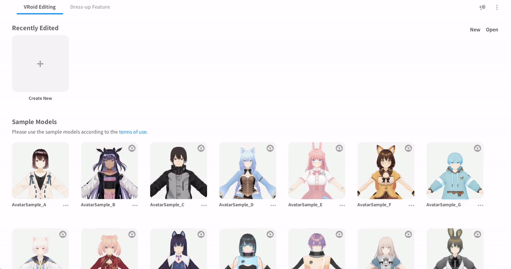
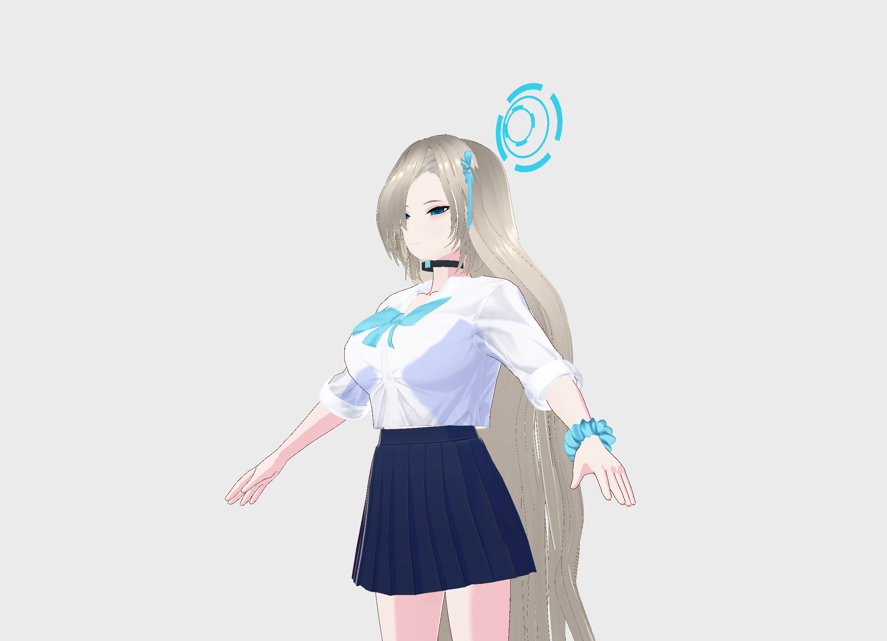
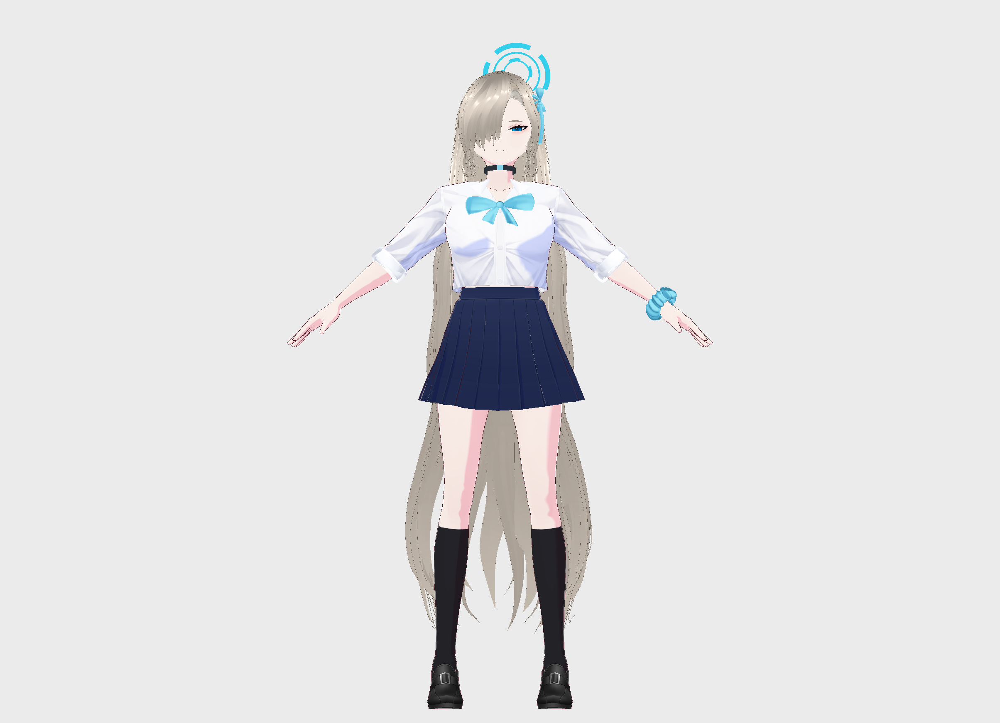
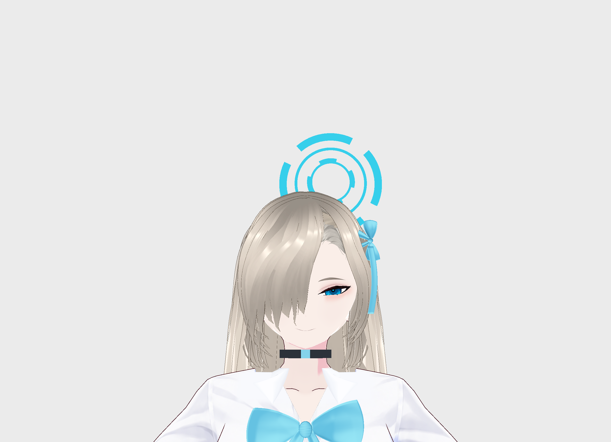

# vroid-studio-mcp

[한국어](README.ko.md) | [English](README.md) | [Русский](README.ru.md)



`vroid-studio-mcp` — **расширение VRoid Studio 2.14.0 с интерфейсом MCP**. BepInEx-плагин внутри
приложения позволяет ИИ-агентам создавать и редактировать персонажей через внутренний API.
Экспериментальные инструменты связывают приложение с ComfyUI для работы с текстурами и Blender
для изменения геометрии лица и создания аксессуаров.

MCP служит интерфейсом управления. Плагин также отображает дополнительную геометрию внутри
VRoid Studio и восстанавливает её из сохранённых моделей.

## Пример: исследовательская модель Асуны

Незавершённая фанатская модель **Асуны (Blue Archive) в школьной форме**. Основной референс —
официальная иллюстрация Mx2J. Штатные параметры лица, пряди волос и одежда сочетаются с
отредактированными текстурами, дополнительной геометрией глаз, аксессуарами и нимбом.



| В полный рост | Лицо и глаза |
|---|---|
| [](docs/images/asuna/asuna-v49-body.png) | [](docs/images/asuna/asuna-v49-face.png) |

Это неизменённые снимки превью **сохранённой и повторно открытой модели V49**, а не сгенерированные
концепты или рендеры Blender. Для V49 записаны 56 проверок работы, сохранности данных и повторного
открытия; также проверены 153 массива ключей формы Blender и упакованные PNG. Технические проверки
не означают завершённого сходства с оригиналом. Волосы, ленты и одежда ещё дорабатываются;
более поздний кандидат V50 с новой лентой здесь не показан.
[Происхождение снимков](docs/images/asuna/README.md).

Работа потребовала многократных сравнений с референсом и отдельных правок. Это не демонстрация
автоматического создания персонажа по одному изображению. Модель персонажа и сторонние исходные
ресурсы в репозиторий не включены.

## Что сохраняется и для чего нужен плагин?

| Слой | Назначение | Повторное открытие |
|---|---|---|
| Штатные правки VRoid | Пресеты, параметры, цвета, штатные волосы и редактируемые текстуры | Сохраняются как обычные данные модели; не зависят от отображения дополнительной геометрии |
| Экспериментальная геометрия | Правки лица на основе того же исходного меша, подводка, вставки волос, воротники, ленты и нимб | Пакет и текстуры встроены в `.vroid`; для отображения нужен загруженный плагин |
| Внешние инструменты | Работа с текстурами в ComfyUI, мешами и запеканием в Blender | Нужны для соответствующего этапа редактирования; для открытия встроенного результата не требуются |

### Как открыть модель с расширением

1. Запустите **ту установку VRoid Studio, где находятся BepInEx и `VroidStudioMcp.dll`**. Если
   используется отдельная рабочая копия, запускайте её `VRoidStudio.exe` явно. Двойной щелчок по
   `.vroid` может открыть другую, обычную установку через файловую ассоциацию.
2. Откройте сохранённый `.vroid` из приложения и дождитесь загрузки модели. Плагин автоматически
   восстановит встроенную геометрию; отдельно импортировать JSON или запускать Blender/ComfyUI
   для уже сохранённого встроенного результата не требуется.
3. Если дополнительные детали отсутствуют, проверьте загрузку плагина и вызовите
   `face_bridge_status` через MCP. У активного пакета должны совпадать сохранённый и активный хеши,
   а ошибка выполнения должна отсутствовать. При изменении исходного меша или потере носителя
   пакета используйте [инструкции восстановления](docs/face-bridge.md#compatibility-and-recovery).

**Обычная VRoid Studio без плагина не активирует дополнительную геометрию.** Сохранение `.vroid`
не превращает эти детали в штатные редактируемые элементы VRoid. Импорт произвольной сцены Blender,
штатный экспорт расширения в VRM, симуляция ткани и полная поддержка выражений/анимации не входят
в проверенный процесс. Перед дальнейшими штатными правками сохраняйте модель и контрольную копию.

## Возможности

- **Экспериментальный макияж глаз** — явная замена альфа-канала позволяет менять прозрачность
  и контур подводки с точным восстановлением RGBA. Проверены подводка, ресницы и тени через
  FacePaint, рендер и сохранение/повторное открытие модели. Преобразование FacePaint в редактируемые
  слои предварительно сохраняет копию модели. [Подробности](docs/makeup-editing.md).
- **Экспериментальное редактирование геометрии волос** — просмотр групп и прядей, перемещение
  контрольной точки кистевой пряди (кроме корня) и восстановление изменения. Проверены резервные
  копии, ревизии, рендер и сохранение/повторное открытие модели с чёлкой. Автоматическое создание
  причёски по изображению и редактирование направляющих пока не реализованы.
  [Контракт и требования к рендеру](docs/external-api.md#hair-geometry).
- **Создание и редактирование персонажа** — создать или открыть персонажа, дать агенту его
  построить и сохранить (`.vroid`).
- **Управление редактором** — поддерживаемые разделы (`Face`, `Hairstyle`, `Body`, `Outfit`),
  категории, пресеты и отдельные ползунки/цвета.
- **Живая визуальная обратная связь** — агент получает отрендеренные превью модели и миниатюры
  пресетов, поэтому решения принимаются по картинке, а не наугад.
- **Качественный рендер превью** — настраиваемые MSAA и суперсэмплинг (SSAA) вместе с
  анизотропной фильтрацией дают чистое и резкое превью для оценки.
- **Читаемые имена пресетов** — VRoid не даёт человекочитаемых имён; плагин их добавляет, поэтому
  пресеты различаются по смыслу, а не по внутреннему id.
- **Исправленные английские подписи** — в английском переводе редактора разные ползунки названы
  одинаково; плагин чинит эти подписи прямо в интерфейсе.

## Как это работает

- Плагин подключается к **собственному внутреннему API** VRoid Studio и вызывает его напрямую.
  Команды используют методы движка вместо эмуляции мыши/клавиатуры; визуальная обратная связь
  поступает из отрендеренных превью.
- Дополнительные меши Blender отображаются отдельным рендерером плагина. Пакет встраивается через
  сериализатор приложения и восстанавливается после открытия и поддерживаемых перестроений модели.
  См. [мост для лица и аксессуаров](docs/face-bridge.md).
- Раз GUI не затрагивается, плагин **продолжает работать, пока окно в фоне или свёрнуто** —
  можно запустить длинное редактирование и переключиться на другое приложение: агент продолжит.
- **Wine поддерживается из коробки.** При запуске VRoid Studio через Wine в Linux пути
  транслируются в обе стороны автоматически, поэтому агенты и скрипты на машине просто
  используют обычные Linux-пути для открытия и сохранения файлов — настраивать ничего не нужно.

## Требования

- **VRoid Studio 2.14.0** (Windows либо через Wine) — [официальный сайт](https://vroid.com/en/studio).
- **BepInEx 6 для Unity IL2CPP** — скачать
  [BepInEx-Unity.IL2CPP-win-x64-6.0.0-be.788](https://builds.bepinex.dev/projects/bepinex_be/788/BepInEx-Unity.IL2CPP-win-x64-6.0.0-be.788%2B5b766a3.zip).
  Всё остальное, что нужно плагину, уже входит в BepInEx.
- **Необязательные инструменты:** ComfyUI для внешней обработки текстур, Blender и Python для
  экспериментального моста геометрии. Устанавливаются отдельно; для базового управления редактором
  и открытия модели со встроенным пакетом не нужны.

## Установка

1. Установить сборку BepInEx из раздела **Требования** в папку VRoid Studio и один раз запустить приложение,
   чтобы BepInEx завершил настройку.
2. Скопировать файл плагина в папку плагинов BepInEx, чтобы получилось:
   ```
   <VRoidStudio>/BepInEx/plugins/VroidStudioMcp.dll
   ```
3. Скопировать две папки с данными в папку VRoid Studio (ту, где лежит `VRoidStudio.exe`):
   ```
   <VRoidStudio>/i18n/      # исправленные английские подписи
   <VRoidStudio>/labels/    # читаемые имена пресетов
   ```
4. Необязательно: скопировать поставляемый конфиг BepInEx, чтобы не писались логи:
   ```
   <VRoidStudio>/BepInEx/config/BepInEx.cfg
   ```
5. Запустить VRoid Studio. Плагин поднимает MCP-эндпоинт по адресу `http://127.0.0.1:17891/mcp`.

### Что в релизе

Архив содержит **только этот плагин и его данные** — никогда саму VRoid Studio и никогда BepInEx
(они устанавливаются отдельно):

```
BepInEx/plugins/VroidStudioMcp.dll   плагин
BepInEx/config/BepInEx.cfg      конфиг BepInEx с выключенными логами
i18n/                           исправленные английские подписи
labels/                         читаемые имена пресетов
README.md  README.ko.md  README.ru.md  LICENSE
```

## Быстрый старт

Указать в MCP-клиенте локальный эндпоинт, например:

```json
{ "mcpServers": { "vroid-studio-mcp": { "url": "http://127.0.0.1:17891/mcp", "type": "http" } } }
```

Дальше достаточно попросить агента сделать то, что нужно, например: *«Создай девушку с коротким
бобом и зелёными глазами и сохрани в мои Документы»*. Агент сам посмотрит доступные разделы,
пресеты и параметры, применит изменения и проверит результат на отрендеренном превью.

## Настройка

Настройки — в `<VRoidStudio>/BepInEx/config/com.kokokoshka.vroidstudiomcp.servers.json`. Значения по
умолчанию разумны; те, что могут пригодиться:

| Параметр | По умолчанию | Что делает |
|---|---|---|
| `enabled` | `true` | включает/выключает сервер управления |
| `msaa_samples` | `4` | сглаживает превью (применяется при перезапуске) |
| `render_scale` | `2` | рендерит превью в большем разрешении — картинка резче |
| `aniso_filtering` | `true` | текстуры под углом чётче |

Если превью тормозит, поставить `render_scale` = `1`.

Адрес (и эти переключатели) можно менять и внутри VRoid Studio: **Настройки** открываются по
иконке аккаунта, раздел **Programmatic Control (MCP)** — сверху.

## Экспериментальное редактирование текстур и ComfyUI

Через MCP доступны поиск редактируемых слоёв, экспорт/импорт PNG и восстановление резервной копии.
Для радужки проверены обработка в ComfyUI/Qwen, изменение 3D-превью, точное восстановление и
сохранение/повторное открытие `.vroid`. Отдельный Python-мост поддерживает настраиваемые API-workflow,
просмотр до применения, проверку альфа-канала и детерминированный тестовый режим.
См. [настройку и команды](tools/comfy-bridge/README.md) и
[результаты и ограничения](docs/texture-interop-findings.md).
Для пользовательских элементов пока доступен только список; импорт/применение и экспорт VRM не реализованы.

## Документация для разработчиков

- [docs/internal-api.md](docs/internal-api.md) — реверс-инжиниринг внутреннего API VRoid Studio.
- [docs/external-api.md](docs/external-api.md) — поверхность управления, отдаваемая клиентам (MCP).
- [docs/architecture.md](docs/architecture.md) — как устроен плагин и как его расширять.
- [docs/character-editing-harness.md](docs/character-editing-harness.md) — работа с референсами,
  разбор визуальных ошибок, проверки результата и шаблон записи сеанса.
- [docs/quirks.md](docs/quirks.md) — поведение движка, на котором легко ошибиться.
- [docs/macos.md](docs/macos.md) — состояние macOS.
- [AGENTS.md](AGENTS.md) — процесс сборки/тестирования и соглашения.

[docs/artist-agent-prompt.md](docs/artist-agent-prompt.md) — пример system prompt для агента в роли
художника персонажей.

## macOS

macOS — **ещё на этапе исследования** и в этот релиз не входит. На Apple Silicon это осуществимо (сам плагин
не зависит от платформы), но требует сборок BepInEx/Il2CppInterop, которых пока нет в upstream
BepInEx. См. [docs/macos.md](docs/macos.md).

## Экспериментальный перенос лица из Blender

Исследовательскую модель лица/глаз из Blender на основе того же исходного меша можно вернуть
в приложение через `face_import`, сохранить внутри `.vroid` и восстановить при открытии.
То же расширение поддерживает подогнанные аксессуары с поддерживаемыми привязками к костям.
**Для отображения дополнительной геометрии необходим плагин.** Экспортёр рассчитан на соответствующий
захваченный исходный меш и его выбранные позы; это не универсальный импорт `.blend`.
Интеграция с экспортом VRM не проверена. См.
[процесс и ограничения](docs/face-bridge.md) и [API](docs/external-api.md#blender-face-bridge).

## Об использовании ИИ

Большая часть реверс-инжиниринга и начальной реализации выполнены с помощью ИИ-агентов:
**DeepSeek V4.1 Flash** в **OpenCode**. Все результаты ИИ проверялись вручную и верифицировались на
запущенном приложении (детерминированные встроенные тесты и рантайм-проверки); без проверки ничего не
принималось.

## Правовая заметка

Это проект для исследования совместимости и автоматизации. VRoid Studio, BepInEx и другие
сторонние компоненты принадлежат их владельцам и не входят в поставку. Использование — на свой риск.

Снимки Асуны показывают неофициальное фанатское техническое исследование. Дизайн персонажей
Blue Archive и сторонние ресурсы принадлежат их правообладателям; лицензия MIT на код не даёт прав
на эти дизайны или ресурсы. Проект не связан с их владельцами и не одобрен ими.

## Лицензия

[MIT](LICENSE) © Ilya Chelyadin and vroid-studio-mcp contributors.
